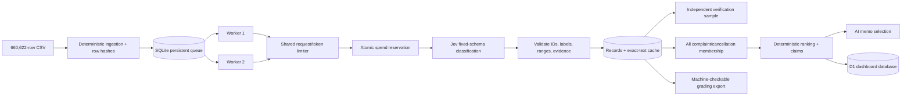

# Assignment 5 — Spotify Insight Pipeline dataset

## Start here

1. Unzip `spotify-insight-dataset.zip`.
2. A convenient starting design is SQL/code for preparation and Jev for fixed labels; choose the tools that fit your pipeline. Build the required calculator in `COST_CALCULATOR.md`; measure a real cold/warm run on `cost_100.csv` before scaling to `checkpoint_500.csv`. Save outputs and an offline replay command so graders need no API key.
3. Hand-label `golden_50_to_label.csv`. These 50 reviews are separate from the development checkpoints. Keep their human answer labels out of prompts; their original texts are still part of the full final run.
4. In Class 7, ingest and profile `spotify_reviews_18months.csv` (660,622 rows; 97,400,616 bytes), then classify all 660,609 nonempty texts and explicitly quarantine the 13 empty texts. Use `analysis_10000.csv` as a development and budget checkpoint first.
5. Read `GRADING_CONTRACT.md` for common labels, bounded tasks, saved outputs, and the required grading export. Use the checker instructions below; it makes no model calls.
6. Follow the full assignment brief on the course site: `assignment5.html`.

The CSV size is 97.4 decimal MB (92.9 MiB). The ZIP download is smaller. Review text may contain embedded line breaks; physical line counts are not row counts.

## API keys: keep them local

For the suggested setup, you will need **an OpenAI or Claude (Anthropic) API key, plus a Jev (TypeSafe) API key**. You do not need both OpenAI and Claude. Other implementations need only their own provider credentials; local models may need none. Check API billing/credits before the pilot.

In your project root, commit a blank `.env.example`:

```dotenv
OPENAI_API_KEY=
ANTHROPIC_API_KEY=
TYPESAFE_API_KEY=
```

`TYPESAFE_API_KEY` is for Jev. Copy this example to a local `.env`, fill in only the keys you use, and load them as environment variables through your program (for example, with a dotenv loader). Add any other provider's variable name to the example with an empty value.

Before your first commit, add these lines to `.gitignore` and commit the ignore file:

```gitignore
.env
.env.*
!.env.example
```

Before pushing, `git check-ignore .env` should print `.env`; `git ls-files -- .env '.env.*'` should list only the blank `.env.example`, if tracked. Inspect staged changes for secrets. If `.env` was already tracked, use `git rm --cached .env`; ignore rules do not untrack it. Revoke/rotate any key that was committed or shared; deleting the file does not erase Git history.

## Parallel enrichment runner

`run_pipeline.py` uses a persistent SQLite `pending` / `in_flight` /
`completed` queue, atomic claims and commits, an exact-text cache with direct
original `cache_source_id` provenance, and a shared request/token limiter. The
default is two workers; pass `--workers 1` for the baseline. A persistent spend
ledger reserves the configured worst-case per-review cost before dispatch and
stops admission when spent + reserved + the next reservation would exceed the
cap. The default cap basis is $10 per 100,000 rows in the selected slice.

Provider request batch size remains **1 review/request**. The earlier measured
multi-state experiment returned one aggregate answer instead of one validated
answer per review, so larger provider requests could silently lose ID-level
results. Local SQLite queueing and two-worker concurrency supply safe
parallelism without changing that provider batch size.

Existing `in_flight` rows are never automatically retried because a timed-out
request may still have been charged. Inspect them first and use
`--recover-in-flight` explicitly. Transient failures use bounded exponential
backoff with jitter; invalid model output is retried at most once.

Resume the 100k checkpoint later (do not run until the scaling decision is
approved):

```bash
python run_pipeline.py spotify_reviews_18months.csv \
  --out grading_full --limit 100000 --workers 2 --spend-cap 10
```

The original single-worker implementation is preserved as
`run_pipeline_legacy.py` for audit history; it is not the active runner.

Never put keys in code, browser code, prompts, notebook outputs, screenshots, logs, or submitted artifacts. Submit `.env.example`, `.gitignore`, and setup instructions, **never `.env` or actual keys**. Offline calculator replay and grading checks must work without credentials.

Setup references: [OpenAI key safety](https://help.openai.com/en/articles/5112595-best-practices-for-api-key-safety), [Claude authentication](https://platform.claude.com/docs/en/manage-claude/authentication), [Jev quick start](https://docs.typesafe.ai/introduction/quickstart), and [GitHub ignore rules](https://docs.github.com/en/get-started/git-basics/ignoring-files).

## Provenance

- Creator: BwandoWando.
- Source: https://www.kaggle.com/datasets/bwandowando/3-4-million-spotify-google-store-reviews
- Version: 2, published November 17, 2023.
- Publisher-listed license: CC0: Public Domain.
- Pinned source download: https://www.kaggle.com/api/v1/datasets/download/bwandowando/3-4-million-spotify-google-store-reviews?datasetVersionNumber=2
- Source archive: 273,598,020 bytes; original CSV: 655,836,189 bytes; 3,377,423 rows.

This course extract includes all source rows dated 2022-05-17 (inclusive) through 2023-11-17 (exclusive). The last observed review is dated 2023-11-15. The original row index, author names, and author IDs were removed. `author_app_version` was renamed to `app_version`; other retained values are unchanged. Review text itself has not been redacted or translated.

## Fields

- `review_id`: original stable review ID.
- `review_text`: original customer text.
- `review_rating`: original star rating, 1–5; not an assigned severity label.
- `review_likes`: helpful-vote count in the source snapshot.
- `app_version`: source app-version string; often missing.
- `review_timestamp`: original timestamp; timezone unspecified.

The full extract has 13 empty review texts, 159,701 missing app versions, and no repeated review IDs. All these rows remain in the full CSV. Samples use unique nonempty reviews with valid ratings. The 100-review cost pilot is the first 100 rows of the 500-review checkpoint, which is a subset of the 10,000-review development checkpoint; the golden 50 is disjoint from all three. Sample order is determined by SHA-256 with the fixed seed recorded in `manifest.json`.

## Limits

This is a historical snapshot of self-selected public app reviews. It contains no account revenue, plan tier, confirmed churn, or complete customer population. Missing versions and unclear or unsupported-language text need explicit handling. A review expressing cancellation intent does not prove that cancellation happened. The final analysis covers the full corpus; report incomplete classifications and their effect on conclusions. Do not include synthetic evaluation cases in business results.

## Reproduce and verify

Download the pinned source ZIP above, then run:

```sh
python prepare_dataset.py /path/to/spotify-source.zip --output data
```

The script uses only Python's standard library. `manifest.json` records source and output SHA-256 checksums, exact byte sizes, counts, filtering, and sampling rules. No model calls are made during preparation.

Full CSV SHA-256:

```text
1fc85de68a304dd8978b537cfa58793d5f41cbaf417fa32cb53899f83a2fcef6
```

### Checker and partial-scope submissions

The checker has two inputs with different jobs: `--full` is always the complete
source CSV and supplies the full-corpus ingestion profile; `--analysis` defines
the exact set of IDs the grading export is expected to contain. For a complete
submission, point both at the full CSV. For a partial checkpoint, create a
scope CSV containing the selected original rows (unchanged, with the original
six columns), and use that file as `--analysis`. The scope file must be a subset
of the full source and include its header. Do not describe the current scoped
result as full-corpus coverage. Under the latest course guidance, the submitted
analysis must exceed 100,000 original rows; this project uses the first 100,100
source rows as its declared grading scope. The 660,622-row corpus remains the
full-source ingestion reference and an optional extended run.

Example, run from the project root after placing the full source CSV at the
indicated path and preparing `grading/`:

```sh
python3 check_submission.py profile --full /path/to/spotify_reviews_18months.csv --out grading/ingestion.json
python3 check_submission.py reference --full /path/to/spotify_reviews_18months.csv --analysis /path/to/scope.csv --out local-reference.json
python3 check_submission.py check --reference local-reference.json --submission grading --out self-check.json
```

For a full submission, set `--analysis` to the full source CSV. Keep the local
reference and self-check report outside `grading/`; they are audit helpers, not
grading-export files. The checker compares the scope's rows and IDs with the
full source, while still checking that `ingestion.json` describes the entire
source. A scoped partial run can therefore be checked without suggesting that
unprocessed IDs are complete. The output status and coverage are evidence
summaries, not a course grade. See [SUBMISSION_CHECKLIST.md](SUBMISSION_CHECKLIST.md)
for the final packaging and dashboard refresh steps.

## Submission status

The resumable state recorded in this checkout's `grading_full/pipeline_state.sqlite`
began from a historical checkpoint of 490 completed original IDs backed by 428
distinct exact-text results and 429 enrichment attempts (428 succeeded, one
failed attempt later recovered). The authorized 100,100-row TypeSafe/Jev run
resumed that state without discarding or reclassifying valid saved records. It
finished with **100,099 completed classifications, one empty-text quarantine,
zero missing IDs, and 24,137 direct exact-text cache reuses**. The final checker
status is **pass** with no issue counts.

The call log contains 76,231 attempts across enrichment, verification,
grouping, and memo roles. Saved-rate reconstruction gives **$3.0033 actual API
cost** for the submitted scope; the conservative persistent ledger closed at
$7.5967 against a $10 hard cap. Enrichment took about 4 hours 15 minutes.

The private deployed dashboard is:

<https://spotify-insight-haas.eveyygou.chatgpt.site>

It now shows the final 100,100-review scope, final ranking and recommendation,
and two traceable source-review examples. Its D1-backed API uses the same final
saved metrics.

## Architecture



Claims are written only after validated results commit. The exact-text cache key
includes the model/prompt/schema configuration. Cache aliases point directly to
the completed original whose model call is logged; aliases never form chains.

## Rubric mapping

The latest course guidance accepts a declared analysis scope above 100,000
original rows. Evidence listed below is expected for that submitted scope;
development checkpoints demonstrate recovery behavior but are not substitutes
for the final 100,100-row export.

| Requirement | Evidence to include in final package | Current project evidence / limit |
|---|---|---|
| Full accounting and hashes | `grading/run.json`, `grading/ingestion.json`, `grading/records.jsonl.gz` | 100,100/100,100 scoped IDs accounted for; full-source ingestion still records all 13 corpus empties |
| Persistent resume and no repeated paid work | `grading/checkpoint_before.json`, `grading/checkpoint_after.json`, `grading/calls.jsonl.gz`, direct `cache_source_id` | 490-ID starting checkpoint and 100,099-ID final checkpoint retained |
| Two-worker queue and spend safety | benchmark report, implementation, saved ledger/call evidence | `evidence/parallel_benchmark.json`; 1.83× mock-provider speedup and no reservation leak |
| Bounded failure handling | test report plus retained failed/succeeded attempts | `evidence/system_tests/latest.json`; recovered production failures remain in `calls.jsonl.gz` |
| Golden and independent quality checks | labeled evaluation, prediction/error files, verifier report and predictions | Golden/error artifacts plus 50 final verification calls retained |
| Baseline membership/ranking/claims | `grading/membership.csv`, `grading/ranking.csv`, `grading/claims.csv` | 31,582 membership rows; eight ranked issues; checker-recomputed ranking matches |
| Cost and runtime | `cost/` with pilot inputs/outputs, dated rates, measured time and offline replay | $3.0033 measured-rate cost; about 4h15 enrichment; `cost/final_usage.csv` |
| Recommendation and traceability | `grading/memo.md`, claims IDs, dashboard with matching final data | Playback recommendation, supporting metrics, and review IDs deployed |
| Mechanical audit | `check_submission.py`, `self-check.json` | Final status `pass`; zero issue counts |

## Parallel and spend evidence

The fixed slice `[490, 498)` was run under identical empty-cache conditions.
One worker took 1.496 seconds; two workers took 0.817 seconds, a 1.83× speedup.
Outputs were identical, each run issued eight calls, no successful review ID was
charged twice, and no reservation leaked. A separate guard case admitted two
jobs at a $0.0002 cap and left six pending.

The ledger is conservative: a worst-case amount that includes bounded retries is
reserved inside the same transaction that claims a queue row. Dispatch stops
when `spent + reserved + next reservation > cap`. Actual usage remains in the
per-attempt call log; the guard estimate is not presented as the provider bill.

## System and quality tests

`test_system_pipeline.py` uses a localhost-only deterministic provider and
retains a timestamped report. The latest run passed all assertions for:

- instruction-like review text remaining data rather than changing the schema;
- a planted wrong label being detected;
- malformed output causing one bounded retry;
- low-confidence ambiguous output setting `needs_review`;
- a temporary HTTP 503 causing a bounded retry and recovery;
- explicit crash recovery releasing the in-flight reservation.

Synthetic cases never enter the business results. The held-out Golden 50 result
was 84% topic accuracy, 92% intent accuracy, 88% exact severity accuracy, and
0.120 severity MAE. The independent 50-review verifier disagreed on topic for
2/50, intent for 0/50, severity for 4/50, and any field for 6/50. Disagreement is
an escalation signal, not an automatic overwrite.

## One-review trace

Review `66c56c76-ca94-46ef-b0a1-931654ead16d` says that ordered playback was
effectively unavailable without Premium and calls the paywall unacceptable.
The saved enrichment labels it `billing`, `complaint`, severity 4, preserves the
full text as an exact evidence quote, and flags it for human review. The bounded
grouping stage maps it into the Premium-gating family. That membership rolls
into the development theme’s 833 complaints, severity sum/priority score 2,474,
and mean severity 2.970. The memo cites the corresponding saved aggregate, and
the dashboard exposes the review ID and quote alongside those supporting
numbers.

## Failed and ambiguous cases

The production call log keeps the original failed attempt instead of erasing it;
the next successful attempt is a separate request ID. Ambiguous results retain
their best supported label and set `needs_review=true` when confidence is low,
severity is high-risk, or the configured review rule fires. Empty text is not
sent to a model and is quarantined as `empty_review_text`.

## Cost summary

The 100-review cold pilot completed 100/100 records with no final failures. Its
178 saved calls used 177,874 input and 45,148 output tokens across enrich,
verify, group, and memo roles, for $0.0075 at the dated editable Jev rates. The
warm replay took 0.79 seconds and made zero new enrichment calls. The original
cold orchestrator did not persist one trustworthy end-to-end stopwatch value;
the report preserves 25.602 seconds of summed request durations and marks cold
wall time unknown rather than inventing it.

The submitted 100,100-row scope cost $3.0033 at the saved rates. The optional
full-corpus base projection is $42.0892 total ($6.3711/100k rows); the
conservative projection is $48.0465 ($7.2729/100k). Both are below the declared
$10/100k limit. See `cost/report.md` for assumptions and cautions.

Offline replay:

```sh
python3 cost/calculator.py
```

## End-to-end commands

Create and activate a virtual environment, install `requests` and
`python-dotenv`, copy `.env.example` to `.env`, and add only the provider key.
Then run the full orchestrator:

```sh
python run_full_assignment.py spotify_reviews_18months.csv \
  --state-dir grading_full --submission-dir grading \
  --classification-limit 100100 --workers 2 \
  --spend-cap 10 --requests-per-minute 300
```

The script resumes enrichment, runs a fixed 50-case independent verification
sample and a bounded 200-case model-assisted sub-issue sample, builds baseline
membership for every complaint/cancellation, ranks and writes claims, generates
the memo, creates the deterministic input profile/reference, packages compressed
JSONL evidence into `grading/`, and runs the checker. Offline finalization after
all model stages are already saved is available with `--skip-enrich
--skip-model-postprocessing`.

Manual zero-API audit:

```sh
python check_submission.py profile --full spotify_reviews_18months.csv --out grading/ingestion.json
python check_submission.py reference --full spotify_reviews_18months.csv --analysis grading_full/analysis_scope_100100.csv --out local-reference.json
python check_submission.py check --reference local-reference.json --submission grading --out self-check.json
```

## Dashboard and database

The dashboard is a private Vinext/Cloudflare Worker Site with a D1 database.
Tables `dataset_summary`, `issue_rankings`, and `review_evidence` back both the
page and the read-only `/api/insights` endpoint. The deployed database contains
eight final ranked topics plus traceable evidence rows. The deployed page and
database were refreshed from the passing 100,100-review grading artifacts.

## Repository packaging

`.env`, SQLite state, local caches, the 97.4 MB raw CSV, virtual environments,
and local deployment state must remain untracked. Submit the compact source
repository plus `grading/` and `cost/`; put oversized grading artifacts in a
GitHub Release if the repository host rejects them. Before publishing:

```sh
git check-ignore .env spotify_reviews_18months.csv grading_full/pipeline_state.sqlite
git ls-files -- .env '.env.*' spotify_reviews_18months.csv
```

The second command must show only the blank `.env.example` among environment
files and must not show the raw CSV.

## Limitations

- App-store reviews are a self-selected historical sample, not Spotify’s full
  customer population.
- Cancellation language is intent, not confirmed churn.
- Review text can be multilingual, sarcastic, underspecified, or adversarial.
- Exact-text reuse is safe only under the identical model/prompt/schema config;
  semantic similarity is not reused.
- The submitted 100,100-review analysis is an approved scope, not a claim that
  all 660,622 source reviews were classified.
- Model execution, provider billing, and semantic correctness still require
  human review; the mechanical checker validates consistency, not truth.
